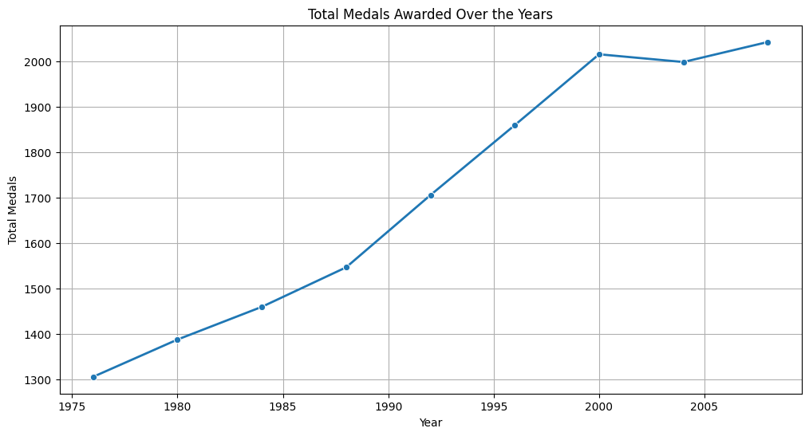
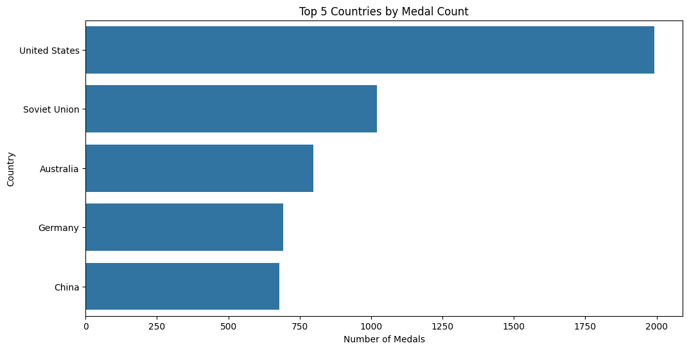
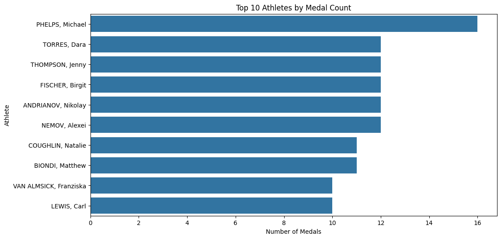
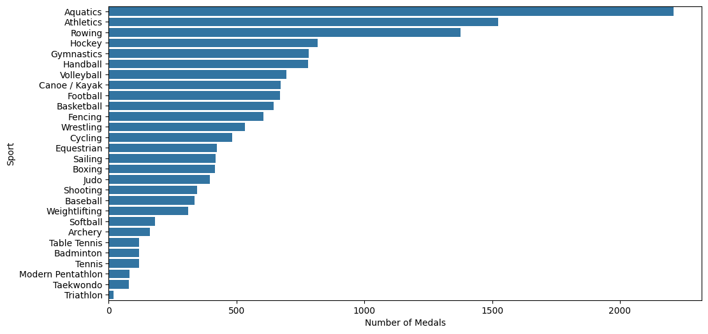
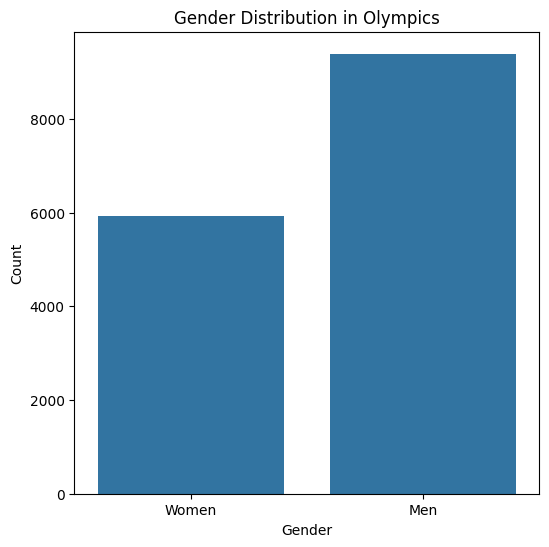
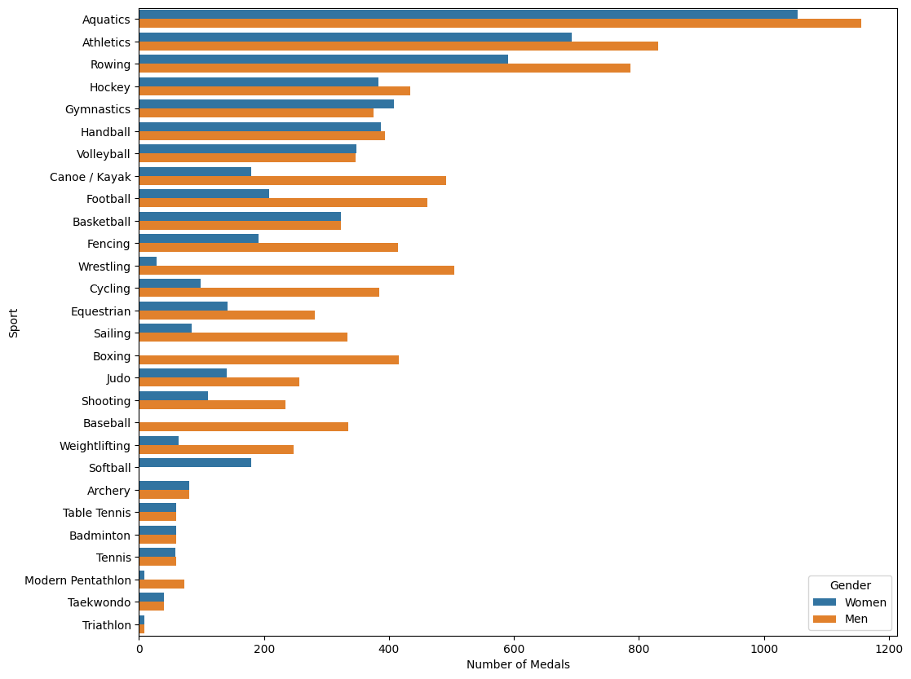
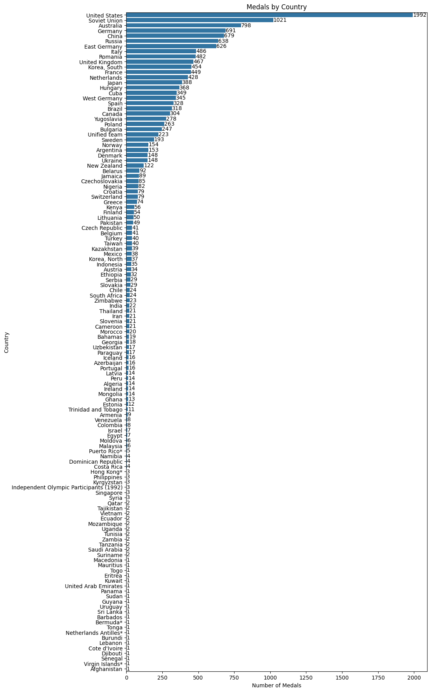

# Olympic Medal Data Analysis

An exploratory data analysis and machine-learning project built around historical Olympic medal results. The notebook cleans and summarizes the dataset, visualizes medal patterns across countries, sports, years, and athlete gender, and trains a Random Forest classifier to predict medal type from event and participant attributes.

## Project contents

| File | Description |
| --- | --- |
| `Olympics_Data.ipynb` | Main notebook: data preparation, exploratory analysis, visualizations, and medal classification. |
| `Olympics data.csv` | Dataset used by the notebook. |
| `assets/` | PNG exports of the notebook visualizations embedded in this README. |

## Dataset

The CSV contains **15,433 rows** and 11 columns. There are 117 rows with missing values; the notebook removes these when preparing the cleaned dataset, leaving **15,316 complete medal records**.

Columns describe the host city and year, sport and discipline, event, athlete, athlete gender, country code and country, event gender, and medal type. The file is read using the `latin1` encoding.

## Analysis workflow

1. **Load and inspect the data** — read the CSV, review column types, and count missing values.
2. **Prepare a clean dataset** — drop rows containing missing values for analyses that require complete records.
3. **Explore medal statistics** — display a sample and summary statistics across the fields.
4. **Visualize medal patterns** — examine medals by year, country, sport, and athlete, as well as gender distribution and gender counts within sports.
5. **Train a medal classifier** — one-hot encode the selected features and train a Random Forest model to classify Bronze, Silver, or Gold.

## Visualizations

The charts below are exported from the notebook's existing plot outputs and use the same dataset and analysis code.

| Medal trends by year | Top five countries |
| --- | --- |
|  |  |

The dataset shows an overall rise in recorded medals from 1976 through 2008. The United States leads the five-country comparison, followed by the Soviet Union, Australia, Germany, and China.

| Top ten athletes | Medals by sport |
| --- | --- |
|  |  |

Michael Phelps appears most frequently among the athletes in this dataset. Aquatics and Athletics have the largest medal counts by sport.

| Medal entries by gender | Medal entries by sport and gender |
| --- | --- |
|  |  |

These charts count the gender recorded on medal rows, not participation across all Olympic athletes. Men have more medal entries than women in this dataset, while the sport-level chart shows how the gender counts vary across sports.

<details>
<summary>Full country medal-count chart</summary>


</details>

The classifier uses `City`, `Year`, `Sport`, `Discipline`, `Event`, `Gender`, `Country_Code`, and `Event_gender` as predictors. The target is `Medal`, mapped to Bronze = 0, Silver = 1, and Gold = 2. The notebook uses an 80/20 train-test split with `random_state=42` and a 100-tree Random Forest.

In a validated run, the model achieved approximately **0.73 accuracy** on the test split. This is a baseline result, not evidence of generalization to future Olympic Games; the current random split may place records from the same Games or events in both train and test sets.

## Getting started

### Requirements

- Python 3.13 (the notebook was run with Python 3.13)
- Jupyter Notebook support, such as JupyterLab or the VS Code Jupyter extension

### Install dependencies

From the project directory:

```bash
python -m pip install -r requirements.txt
```

### Run the notebook

Open `Olympics_Data.ipynb` in Jupyter or VS Code, make sure the notebook kernel is using the environment where the dependencies were installed, then choose **Restart Kernel and Run All**.

The notebook expects `Olympics data.csv` to be in the current working directory. If it is run from another directory, update the CSV path in the data-loading cell.

## Notes and limitations

- The source dataset is limited to the Olympic medal records included in the provided CSV; it should not be assumed to cover every Olympic Games.
- The classifier predicts medal category for rows that already represent medal records. It does not predict whether an athlete or country will win a medal.
- One-hot encoding is performed before the train-test split, so category information from the full dataset is present when constructing the feature columns. For a more rigorous evaluation, fit preprocessing within a scikit-learn pipeline and use a split strategy that holds out entire Olympic years.
- The dataset is historical; country names and codes may reflect the source's original conventions.
